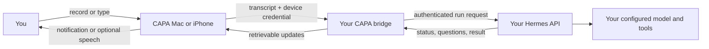

<div align="center">


# CAPA

**Speak a request to your Hermes agent, keep working, and return to the result.**

Free, open-source, experimental · [MIT license](LICENSE) · Native Mac preview · iPhone source

[Get started](#get-started-on-mac) · [See how it works](#how-it-works) · [iPhone setup](#iphone-and-linked-devices) · [Visual demo](#explore-the-visual-demo) · [Contribute](CONTRIBUTING.md)

</div>

> **Project status:** CAPA is an experimental community project, not an official Hermes product or a production-ready service. The Mac companion is built from source; there is no signed download or App Store release. iPhone builds, background push, and locked-screen voice require further device validation. See [what works today](#what-works-today).

## What is CAPA?

CAPA is a lightweight companion for an **existing [Hermes Agent](https://hermes-agent.nousresearch.com/)**. Its Mac widget lets you record a request without staying inside an agent chat window. CAPA transcribes the memo, routes it through a private bridge to your Hermes installation, and keeps the task and result available in a small hub. Notifications are the default; reading results aloud and spoken updates are optional.

Hermes supplies the intelligence, configured tools, model provider and memory. CAPA supplies the interface, task tracking, device pairing and delivery. It doesn't include a hosted agent or provider credits. CAPA is free; your chosen model, speech providers, network infrastructure or Apple developer account may have their own costs.

CAPA is for people who already use Hermes and want to delegate while working in other apps; developers experimenting with a self-hosted agent interface; and curious contributors who want to improve a small, open-source voice companion. Initial setup currently requires comfort with a terminal, an existing Hermes API and local configuration.

### Examples

These are **example requests, not prebuilt automations or guarantees**. What Hermes can do depends on its configured model, tools, permissions and connectivity; review consequential actions and results.

- **Research:** “Compare three options for our next team offsite and include links to your sources.” CAPA tracks the request; open the result later.
- **Development:** “Inspect this repository and explain why the build fails. Don't change files.” Hermes needs access to the repository and appropriate tools.
- **Planning:** “Turn these notes into a prioritized checklist and ask me if a deadline is missing.” A supported clarification appears with the task, allowing you to answer it.
- **Operations:** “Draft a follow-up email based on my notes; show it to me before sending.” Sending or connecting an email service is controlled by your Hermes setup, not by CAPA's demo connector list.

## Why use it?

- **A small control:** record from a draggable Mac widget or menu bar and keep the full task history in the hub.
- **Your own agent:** use your existing Hermes profile, tools and providers rather than creating a second agent inside CAPA.
- **Recoverable work:** CAPA tracks accepted Hermes runs, pending questions, results and ambiguous submissions. A retry uses the same request identity rather than intentionally starting a duplicate.
- **Your devices, one workspace:** explicitly link trusted devices so they can retrieve and control the same tasks. Every linked device has access to the workspace.
- **Choose how updates arrive:** notifications by default, with optional spoken acknowledgment, read-aloud and experimental automatic speech.
- **Honest connections:** the native hub can show toolsets and skills advertised by Hermes. Configure and authorize third-party tools in Hermes.

## How it works



The bridge runs as a single process beside Hermes or on your own host. It stores task receipts and delivery events in SQLite. Device pairing creates a separate credential stored in the device's Keychain; the Hermes API key stays on the bridge host. A shared workspace uses its own Hermes API session and does not automatically attach to your Telegram or CLI conversations. Independently detached Hermes jobs are not automatically tracked as CAPA tasks. See [bridge architecture and behavior](bridge/README.md).

## What works today

| Component | Implemented | Current boundary |
|---|---|---|
| **Bridge** | Pairing, shared workspaces, task submission and recovery, supported Hermes controls, delivery events and device revocation. | Automated tests use mocked external Hermes/APNs boundaries. Requires a compatible, running Hermes API. |
| **Mac companion** | Native hub, draggable widget, deliberate recording, task history, local notifications and optional speech. | Builds locally on macOS 14+. Real-world hardware, provider and delivery behavior need validation. The Mac must be awake and CAPA running for local notifications. |
| **iPhone companion** | Native app and widget source, pairing, task UI and experimental Push to Talk. | Requires Xcode, signing, a trusted HTTPS bridge and a physical device. APNs and locked-screen speech are **not verified or guaranteed**. |
| **Web showcase** | Earlier animated design with sample tasks, replies and simulated connector settings. | A visual demo only: it does not connect to Hermes, execute tasks, authenticate accounts or authorize tools. |

Android and Windows apps are not implemented. See the [device acceptance procedure](docs/transition/device-validation.md) for scenarios to verify before relying on the companion.

## Get started on Mac

This is the most direct route to trying the real companion. It builds a **local, ad-hoc-signed preview** for the architecture of the Mac doing the build. Allow extra time for dependencies and Hermes setup; this is not a one-minute install.

### Prerequisites

- macOS 14 or later, with Apple Command Line Tools (`xcode-select --install`) or full Xcode, including Swift 6.
- Git and Python 3.11 or later, with `venv` and `pip` available.
- An existing Hermes installation with its API server enabled, an API key and a working model/provider. CAPA's bridge was developed against Hermes v0.22.5; compatibility depends on the endpoints your installation advertises. See the [Hermes API server guide](https://hermes-agent.nousresearch.com/docs/user-guide/features/api-server/).
- A network connection to install dependencies. For the steps below, Hermes and the bridge run on the **same Mac**. For another host or an iPhone, use a trusted HTTPS bridge endpoint as described below.

### 1. Download the source and install the bridge

Open Terminal:

```sh
git clone https://github.com/evyevans/CAPA.git
cd CAPA
python3 -m venv bridge/.venv
bridge/.venv/bin/python -m pip install -e './bridge[test]'
```

If you already have a CAPA checkout, use its directory instead of cloning another copy. The editable install above also installs the bridge test dependencies. For a clean non-editable install, see [bridge setup](bridge/README.md#installed-build-and-real-provider-checks).

### 2. Configure your existing Hermes connection

Create a private configuration file and open it for editing:

```sh
mkdir -p ~/.config/capa
chmod 700 ~/.config/capa
cp -n bridge/.env.example ~/.config/capa/bridge.env
chmod 600 ~/.config/capa/bridge.env
nano ~/.config/capa/bridge.env
```

Set `CAPA_HERMES_KEY` to the API server key for the Hermes profile you intend to use. If Hermes is on this Mac at its default address, keep `CAPA_HERMES_URL=http://127.0.0.1:8642`. Otherwise set the correct URL; a remote Hermes URL must use HTTPS. `cp -n` preserves an existing configuration rather than overwriting it. Save in nano with **Control-O**, Enter, then **Control-X**.

The file is shell-sourced in the next step: only source a configuration file you trust, and use shell quoting for values containing special characters. Don't commit it, paste credentials into issues, or put the Hermes key in the app. CAPA does not configure Hermes or provider credentials for you.

### 3. Start the bridge

In the same terminal, from the CAPA repository root:

```sh
set -a
source ~/.config/capa/bridge.env
set +a
bridge/.venv/bin/capa-bridge serve
```

Leave this terminal running. The default bridge address is `http://127.0.0.1:8787`. It is accessible only on this Mac. The bridge does not install itself as a background service; stopping it pauses reconciliation until it restarts.

In a **second Terminal window**, check that the bridge process is responding:

```sh
curl http://127.0.0.1:8787/health
```

You should see `{"status":"ok"}`. This confirms the bridge is reachable; it does **not** prove Hermes or its model provider is working. If you set a custom `CAPA_DATABASE`, export the same value in both terminals before issuing pairing codes.

### 4. Build and open the Mac app

In the second terminal, change into the cloned CAPA directory, then run:

```sh
bash scripts/package-mac.sh
open artifacts/macos/CAPA.app
```

The script also creates `artifacts/macos/CAPA-Mac-preview.zip`. It is a locally signed preview, not a notarized public installer. See [Mac build notes](macos/README.md) for platform details.

### 5. Pair and send a first request

From the CAPA repository root in the second terminal:

```sh
bridge/.venv/bin/capa-bridge pair
```

Copy the one-use code into CAPA's **Connect your Hermes** screen with the address `http://127.0.0.1:8787`. The code expires after five minutes. A new host code creates a new workspace; it does not link to an existing one. Treat the code as a temporary credential.

In the hub, type a harmless first task such as:

```text
Reply with one sentence confirming that you can receive a CAPA task. Do not use tools or change files.
```

Send it and open the task to check that Hermes accepted and completed it. Once that works, click the widget's waveform to record a memo, then click again to send it. Grant microphone and speech-recognition permissions when requested. The separate widget arrow opens the hub; drag the widget to reposition it.

If recognition or admission fails, use the saved-memo recovery controls. A request is only described as accepted once Hermes returns a run ID. The task view is the place to check results and supported questions or approvals; read details before authorizing actions.

## iPhone and linked devices

The iPhone implementation is source code for an experimental companion, not an App Store download. Follow [iPhone build and signing instructions](ios/README.md): you need full Xcode, an Apple development team, appropriate capabilities and a physical iPhone. The widget opens the app; it does not record by itself.

An iPhone cannot use your Mac's `127.0.0.1` address. Expose the bridge through a **trusted HTTPS endpoint** reachable by the phone, with a certificate the phone trusts. A VPN by itself does not provide HTTPS. Keep the Hermes API on loopback when it shares the bridge host; do not expose API keys to the client. See [bridge networking and TLS](bridge/README.md#install-locally).

To share a workspace, use **Devices → Link another device** on an already paired client and enter its invitation and the same reachable bridge URL on the new device. Invitations expire and work once. A plain host `pair` command creates a separate workspace. Linked devices can read and control all workspace tasks; revoke a lost device in CAPA or with `capa-bridge revoke DEVICE_ID` on the host.

On iPhone, ordinary background alerts require configured Apple Push Notification service credentials and appropriate provisioning. Push to Talk and automatic locked-screen speech are opt-in experiments subject to Apple's platform behavior and device testing; permissions or leaving the app open do not guarantee that CAPA can speak later. Results remain retrievable when the bridge and device reconnect.

## Configuration

The bridge reads environment variables **from its process**, not automatically from a `.env` file. The [example configuration](bridge/.env.example) documents optional values.

| Variable | Purpose | Default / requirement |
|---|---|---|
| `CAPA_HERMES_KEY` | API key for your Hermes profile. | Required; keep on the bridge host. |
| `CAPA_HERMES_URL` | Hermes API base URL. | `http://127.0.0.1:8642`; remote HTTP is rejected. |
| `CAPA_DATABASE` | SQLite bridge database path. | `~/.local/share/capa/bridge.sqlite3`. Use the same path for the service and pairing CLI. |
| `CAPA_POLL_SECONDS` | How often the bridge polls Hermes. | `3`; minimum `1`. |
| `CAPA_APNS_TEAM_ID`, `CAPA_APNS_KEY_ID`, `CAPA_APNS_KEY_PATH`, `CAPA_APNS_BUNDLE_ID` | Apple push credentials and app bundle ID. | Optional; needed for configured iPhone APNs delivery. Keep the key on the host. |
| `CAPA_APNS_SANDBOX` | Select Apple development or production push endpoint. | `true`; use `false` for production signing. |
| `CAPA_HERMES_PYTHON`, `CAPA_HERMES_REPOSITORY` | Explicitly reuse an existing Hermes installation's speech helpers. | Optional; configure both to use host speech. Existing provider usage may cost money. |
| `HERMES_HOME` | Hermes profile used by host speech helpers. | Optional; match the profile used by the API when configuring host speech. |

Only one bridge worker is supported. Keep the database, SQLite sidecars and audio cache private and back them up together while the service is stopped. [Detailed configuration, retention, speech and API routes](bridge/README.md) explain these choices.

## Troubleshooting

| Symptom | Check |
|---|---|
| Bridge fails at startup | Verify `CAPA_HERMES_KEY` is set in the same terminal, Python dependencies are installed, and remote Hermes URLs use HTTPS. |
| Health works but tasks fail | Health checks the bridge only. Verify Hermes is running, the key matches its API profile, the model/provider works, and required API capabilities are advertised. |
| Pairing fails | Confirm the bridge URL and network, generate a fresh five-minute code, and use the same `CAPA_DATABASE` for the bridge and CLI. Use trusted HTTPS for a remote device. |
| No transcription | Grant microphone/speech permissions and check on-device recognition for your language. Configure host speech if needed, or use a typed request. A failed memo is retained for recovery. |
| No notification | Enable OS notifications. On Mac, keep the app running and the Mac awake. On iPhone, verify APNs credentials, bundle ID, provisioning and network. Open CAPA to retrieve saved results. |
| Connection or provider missing | The Connections page is read-only discovery. Configure the tool and its authorization in Hermes; CAPA does not add access on its own. |
| Request outcome unclear | Open the task and use the saved retry/recovery flow. Don't assume completion or manually submit a duplicate while acceptance is uncertain. |

For detailed diagnostics, start with [bridge setup](bridge/README.md), [Mac notes](macos/README.md), and the [device validation procedure](docs/transition/device-validation.md). Never include API keys, pairing codes or private task contents in an issue.

<details>
<summary><strong>Working with a coding agent</strong></summary>

You can give an agent this prompt after cloning the repository:

```text
Help me set up the experimental CAPA Hermes companion from this repository.
Read README.md, bridge/README.md and macos/README.md first. Inspect my platform,
existing Hermes installation and non-secret configuration. Explain any missing
prerequisites. Keep my existing Hermes profiles, providers and credentials intact;
ask before changing them or installing a persistent service. Do not print, request
in chat, commit, or transmit API keys or pairing codes. Guide me through setting
CAPA_HERMES_KEY privately on the bridge host. Build the Mac app and verify bridge
health and a harmless reply-only Hermes task if my environment permits. Report
which steps passed, failed, or still require physical-device testing. Do not claim
APNs, locked-screen audio, or production readiness without testing.
```

A coding agent can help inspect and run setup commands, but it cannot conjure a Hermes provider, Apple signing entitlement, HTTPS certificate or device access that is absent from your environment.

</details>

## Explore the visual demo

The React showcase is a separate look at an earlier CAPA interface. It uses fictional task activity and connector state, not the Hermes bridge. With Node.js 22 LTS and npm:

```sh
npm ci
npm run dev
```

Open the local URL and select **Explore visual demo**. The sample exchange is simulated and does not activate the microphone or contact an agent. Preferences persist in browser storage; Google Fonts load externally. Build and check it with `npm run lint`, `npm run typecheck`, and `npm run build`.

## Development and roadmap

Install bridge test dependencies using the Mac setup above, then run:

```sh
bash scripts/check-companion.sh
```

This runs bridge tests, portable Swift checks, a native Mac build, and iOS syntax/plist checks. It builds for the iOS Simulator only when full Xcode is available. Automated checks do not prove live provider, microphone, APNs or physical-device behavior.

Current priorities are to validate the live Mac → bridge → Hermes flow, test iPhone signing and notification/Push to Talk behavior on real devices, improve first-run setup, and document reliable distribution. Android/Windows clients and a managed connector catalog are not implemented; they are possibilities rather than release promises. See [device validation](docs/transition/device-validation.md) and [release readiness](docs/OPEN_SOURCE_READINESS.md).

Contributions and reproducible reports are welcome: read [CONTRIBUTING.md](CONTRIBUTING.md). For vulnerabilities, follow [SECURITY.md](SECURITY.md) and use GitHub's private reporting channel. CAPA's original code is licensed under the [MIT License](LICENSE); dependencies and third-party marks have their own terms, described in [third-party notices](THIRD_PARTY_NOTICES.md).
